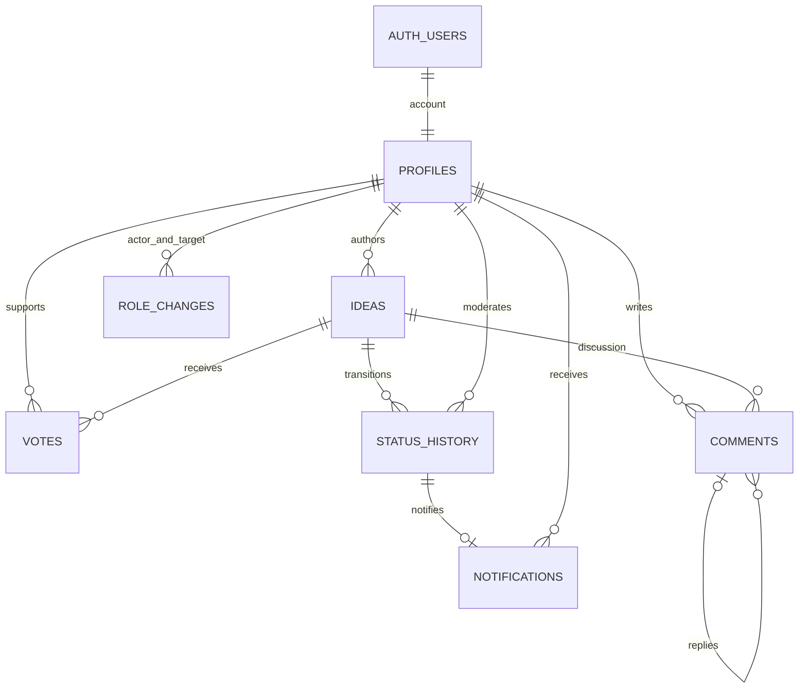

# Данные и серверная логика

Supabase Auth хранит учётные записи и хеши паролей в auth.users. Публичная схема хранит данные приложения. Полный исполняемый источник — supabase_schema.sql.

| Таблица | Назначение |
|---|---|
| profiles | id → auth.users, name, avatar, role, created_at |
| ideas | автор, заголовок, проблема, решение, категория, статус, дата и сведения о скрытии |
| votes | user_id + idea_id — составной первичный ключ, дата |
| comments | автор, идея, текст, UUID запроса, reply_to_id → comments, сведения о скрытии |
| status_history | идея, старый/новый статус, пояснение, модератор, время |
| notifications | владелец, идея, уникальное событие истории, снимок решения и дата прочтения |
| role_changes | кто/кому изменил роль, прежняя/новая роль, дата; закрытый журнал |

Категории, пять статусов и 16 аватарок ограничены CHECK. Текстовые CHECK действуют на прямые записи и RPC. Внешние ключи защищают связи.

## Операции

submit_idea и submit_comment используют UUID запроса и возвращают уже созданную запись при повторе. submit_comment_reply дополнительно проверяет доступный исходный комментарий той же идеи. set_idea_vote задаёт желаемое наличие голоса; уникальный ключ исключает второй голос, снятие действует только на auth.uid().

change_idea_status проверяет роль, блокирует идею и записывает статус с историей в одной транзакции. Триггер создаёт одно личное уведомление на событие. Повтор того же перехода не добавляет историю.

moderator_delete_idea и moderator_delete_comment заполняют deleted_at/deleted_reason/deleted_by. Физическое удаление клиенту запрещено. moderator_restore_idea возвращает видимость идеи. admin_list_users и admin_set_moderator доступны только администратору; назначения пишутся в role_changes.

## Граница доступа

Гости читают открытые идеи, комментарии и историю. RLS дочерних таблиц проверяет видимость родительской идеи. Модератор видит скрытое, обычный участник — нет. Профиль можно менять только свой, только name/avatar; прав на роль у клиента нет. Уведомления читает и отмечает только владелец. Публичный профиль не читает email из Auth. Серверные ключи клиенту не требуются.
